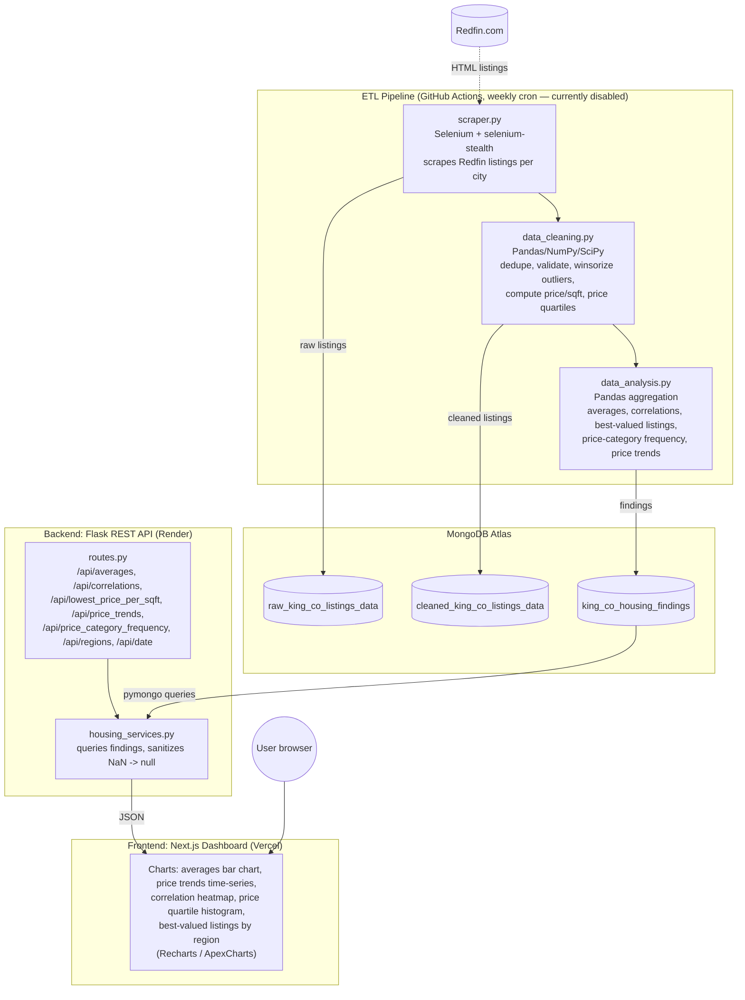

# System Design

> The ETL pipeline (dashed box below) is disabled as of October 2026 — see the status note in [README.md](README.md).
> The API and frontend are unaffected and still serve the last data collected.

## Component notes

- **ETL pipeline** (`backend/data_pipeline/`) — ran weekly via GitHub Actions (`.github/workflows/main.yml`), scraping all King County cities listed in `scraper_config.py`, cleaning/validating with Pandas, and writing aggregate findings to MongoDB. Disabled because Redfin blocks GitHub-hosted runner IPs.
- **Database** (`backend/database/`) — MongoDB Atlas (free M0 tier). Three collections: raw scraped listings, cleaned/validated listings, and precomputed findings the API serves directly (so the API never does heavy aggregation at request time).
- **Backend API** (`backend/housing_data_API/`) — Flask app on Render, rate-limited with Flask-Limiter, reads precomputed findings from MongoDB and returns JSON to the frontend.
- **Frontend** (`frontend/king-county-dashboard/`) — Next.js dashboard on Vercel, renders the charts described in the main README.
